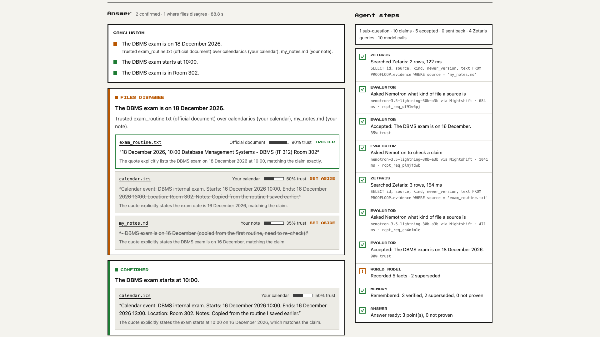

# Proofloop

> A team of AI agents that answers questions from your own files, and proves every answer.

Open Agent Hackathon 2026 · Track 1: Solving Fragmented Intelligence

## About the Project

Proofloop reads a folder you choose (PDFs, notes, spreadsheets, calendar exports, chat exports) and answers your questions only with evidence. Every answer shows the exact line it came from. When files disagree, Proofloop says which file it trusts and why; when nothing proves an answer, it says **Not proven** instead of guessing.

We built it for anyone whose important details are scattered across many files: students, job seekers, travellers, small teams.

## The Problem

Information is fragmented across files, formats and versions. Documents are revised, copied and summarised, and the copies often contradict one another: a final notice and an old draft, a calendar entry copied from the wrong version, a rumour in a group chat. Checking which source is right takes time, and a typical AI assistant returns one confident answer without evidence, even when the sources disagree.

## The Solution

Proofloop treats every question as a small investigation. Its agents search your files, attach an exact quote to every claim, check each quote against the source, and settle disagreements by how trustworthy each source is (an official document outweighs a personal note, and an older version counts less). The result has three possible outcomes:

- **Confirmed:** the answer, with the line that proves it.
- **Files disagree:** the answer from the most trusted file, with the sources that were set aside.
- **Not proven:** no reliable evidence, so no guess.

## Demo

- **Live Demo:** runs locally (see [Getting Started](#getting-started)); sample mode needs no accounts or keys.
- **Demo Video:** https://youtu.be/iDL9hR9CAC8



The demo folder is in [`samples/student-desktop/`](samples/student-desktop/) (fictional college, company and people). Three example questions and outputs:

| Question | Answer |
|---|---|
| When is my DBMS exam? | Files disagree → **18 Nov 2026**, from the final exam routine, over the calendar and to-do list (16 Nov) |
| When does my internship start? | Files disagree → **5 Jan 2027**, from offer letter v2, over v1 (15 Dec 2026) |
| Was the mini project deadline extended? | **Not proven**: only a class-group rumour; the brief says 12 Nov 2026, 5:00 PM |

## Key Features

- **Choose any folder:** reads PDF, text, Markdown, CSV and calendar (.ics) files, including subfolders.
- **Understands messy folders:** reads identical copies once and trusts the newest version of a file.
- **Exact proof:** every point cites the exact line; click a file to open it with the line highlighted.
- **Conflicts explained:** shows which file was trusted, which were set aside, and why.
- **Refuses to guess:** rumours and unsupported claims are marked **Not proven**.
- **Live agent steps and activity log:** every search, model call and decision appears as it happens, with the database query and model receipt behind it.
- **Across your folder:** a table of every file and what the agents did with it.

## How It Works

1. You choose a folder and ask a question in plain words.
2. The folder is loaded into **Zetaris** as a searchable table (duplicates skipped, older versions marked).
3. The **Planner** splits the question; the **Investigator** searches Zetaris and drafts claims, each with an exact quote.
4. The **Evaluator** checks each quote word for word in code, checks its meaning with the model, rejects hearsay and sends weak claims back for another try.
5. The **World Model** settles conflicts by source trust, and **Memory** stores what was proven.
6. You get the conclusion, the proof for each point, and the full log of how it was reached.

## Built With

- **Language:** TypeScript (Node.js 20+), plain HTML/CSS/JavaScript for the interface
- **Framework:** none; Node's built-in HTTP server, Vitest for tests
- **Tools / Models:**
  - **NVIDIA Nemotron 3.5 Lightning** (`nvidia/nemotron-3.5-lightning-30b-a3b`): the model behind every agent
  - **Meterless Nightshift:** the AI runtime; every model call returns a receipt
  - **Zetaris:** the data layer; documents become a Lightning SQL table and every search is a Zetaris query
  - **Meterless World Model:** facts with provenance and the conflict policy
  - **Meterless H-MEM:** per-folder memory with an audit ledger

More detail: [docs/SPONSORS.md](docs/SPONSORS.md).

## Getting Started

### Prerequisites

- [Node.js](https://nodejs.org) 20 or newer, and Git
- For the live version (not needed for sample mode):
  - Meterless Nightshift running, with NVIDIA set up as a provider (Setup → Providers → NVIDIA)
  - [Docker Desktop](https://www.docker.com/products/docker-desktop/) running the Zetaris local platform

### Installation

1. Clone the repository.
   ```bash
   git clone https://github.com/marasinibishesh/ProofLoop.git
   ```
2. Open the project directory.
   ```bash
   cd ProofLoop
   ```
3. Install the dependencies and the Meterless engines.
   ```bash
   npm install
   npm run setup
   ```
4. Configure the environment variables (live version only).
   ```bash
   cp .env.example .env      # Windows: copy .env.example .env
   ```
   Fill in `METERLESS_RUNTIME_TOKEN` (from Nightshift), `ZETARIS_ORG_ID` and `ZETARIS_API_KEY` (from the Zetaris web app), then check every connection:
   ```bash
   npm run check
   ```
5. Start the application.
   ```bash
   npm start          # live version: Nemotron via Nightshift, data in Zetaris
   npm run sample     # sample mode: no accounts or keys, pre-written agent replies
   ```
   Open http://localhost:4317, click **Choose folder**, pick a folder (for example `samples/student-desktop`) and ask a question.

Run the tests with `npm test`.

## Challenges and Learnings

- **The model copied answers between sources.** When several files mentioned the same exam, Nemotron sometimes wrote the calendar's date into the claim for the official notice, and an identical sentence from a second file was skipped as a duplicate. We now ask for the quote first and the claim second, check every quote in code, and treat the same sentence from a different file as new evidence. We learned to verify the model's output in code instead of trusting it.
- **Fitting Zetaris to a local folder.** Lightning SQL has no `IF NOT EXISTS`, a filestore table behaves as a view, and quotation marks inside CSV text need an explicit escape option. We now rebuild the evidence table on every load and verify that every passage in Zetaris matches its source.
- **Showing real work, not animation.** The live timeline streams real trace events from the server, so every row on screen is something the agents actually did.

## Contributors

- [Rajesh Khadka](https://github.com/rajeshkhadka200)
- [Bishesh Marasini](https://github.com/marasinibishesh)

## Acknowledgements

- **Open Agent Hackathon 2026** and its sponsors: NVIDIA, Zetaris and Meterless.
- **Pre-existing components (declared):** the Meterless H-MEM and World Model reference engines (Apache-2.0), downloaded unmodified into `vendor/` by `npm run setup`; the engine loader pattern from the Meterless `agentathon-starter` template; the Zetaris local platform image; and the [Press Start 2P](https://fonts.google.com/specimen/Press+Start+2P) font (SIL Open Font License, licence in `web/fonts/OFL.txt`). Everything else was written during the build window (22–27 October 2026).
- **Libraries:** [openai](https://www.npmjs.com/package/openai) (client for Nightshift's OpenAI-compatible API), [dotenv](https://www.npmjs.com/package/dotenv), [unpdf](https://www.npmjs.com/package/unpdf) (PDF text).
- Cursor was not used in this project.

## License

MIT. See [LICENSE](LICENSE).
